[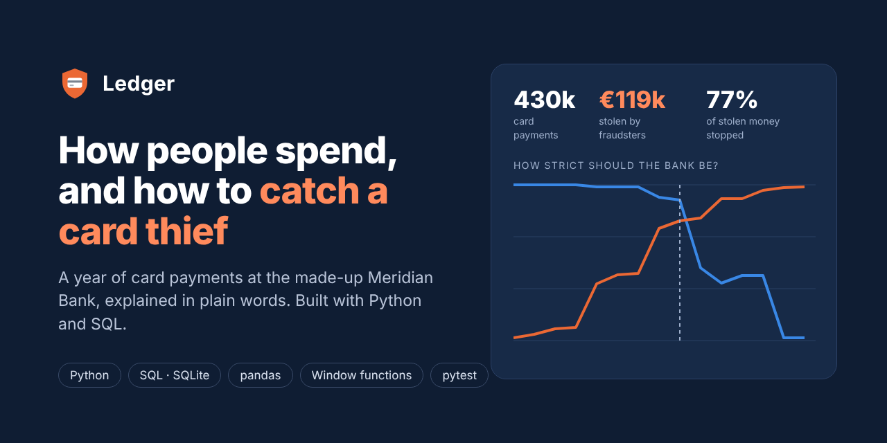](https://diogos7.github.io/Ledger/)

# Ledger

[](https://github.com/DiogoS7/Ledger/actions/workflows/ci.yml)

**How people spend, and how to catch a card thief.** Try it live: **[diogos7.github.io/Ledger](https://diogos7.github.io/Ledger/)**

Ledger follows a year of card payments at Meridian Bank, a made-up Portuguese bank: 430,000 payments from 1,500 customers. It answers three questions in plain words, for anyone to read:

1. **Where does the money go?** What people spend on, when they pay, and how fast tapping the card is taking over.
2. **How do fraudsters steal?** Three common tricks, where the money goes and how long people take to notice.
3. **How do you catch them?** Six simple checks look at every payment and give it points. Enough points and the payment is stopped.

Under the hood it is a data analysis project in **Python and SQL**: a SQLite database, SQL queries for every number, fraud checks written as SQL, and Python (pandas) to score how well they work.

**Ask it with AI:** [Ledger MCP](https://github.com/DiogoS7/Ledger-MCP) is an MCP server for this project. It lets Claude or another AI assistant query the data, explain why a payment was blocked, find fraud that was missed, and try out stricter or looser checks.

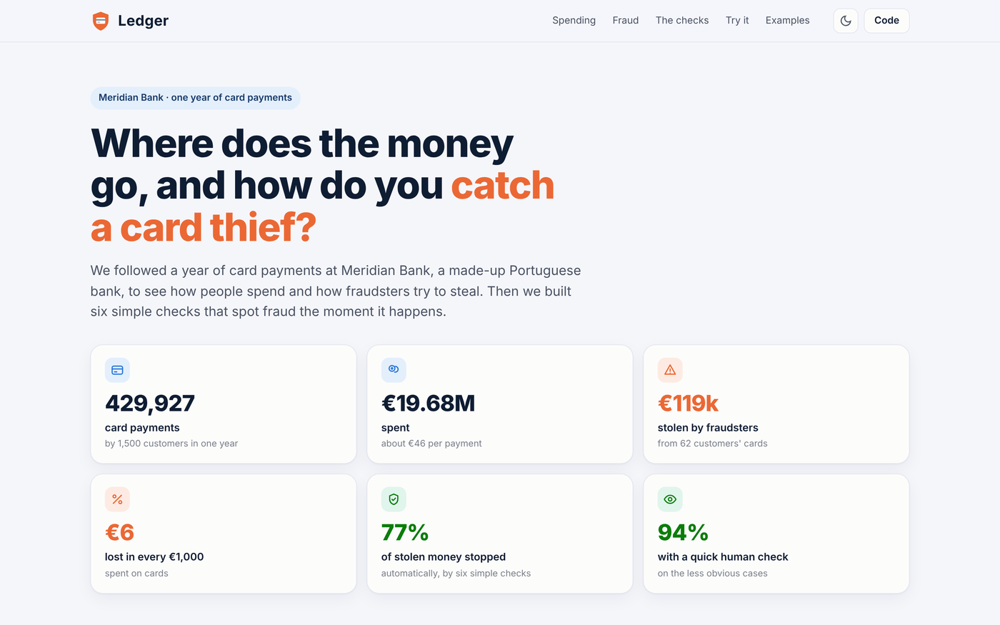

## What we found

- **Most fraud happens online.** €74 of every €100 stolen was taken through online shopping. Tapping a card in a shop: €0.
- **Fraudsters spend abroad.** 79% of the stolen money went outside Portugal, where only 5 in 100 payments happen.
- **Simple checks stop most of it.** Working together, six checks stop 77% of the stolen money automatically, and 9 in 10 of the payments they stop really are fraud.
- **A quick human look catches more.** Checking the less obvious cases by hand raises that to 94%.
- **People notice too late.** Half of the victims took 12 days or more to report it, so the bank has to act the moment the payment is made.
- **Tapping is taking over**, from 53% to 71% of shop payments in one year.

## The six checks

| Check | In plain words | Aimed at | Alerts that are real fraud |
| --- | --- | --- | ---: |
| Rapid-fire charges | The same card is charged 4+ times within 10 minutes | Card testing | 10 in 10 |
| Test, then spend | A €200+ online purchase right after a few tiny test charges | Card testing | 10 in 10 |
| Two places at once | Used in a shop abroad within 2 hours of being used in Portugal | Copied card | 3 in 10 |
| Unusually big payment | €250+ and 8 times bigger than this card usually spends | Hijacked account | 3 in 100 |
| Late-night risky shop | €150+ online at electronics, jewellery, gift cards or crypto, midnight to 5am | Hijacked account | 7 in 10 |
| New country, risky shop | The card's first payment at a risky kind of shop in a new country | Hijacked account | 1 in 10 |

Each check adds points. **Under 35** the payment goes through, **35–59** someone at the bank takes a look, and **60 or more** the payment is stopped and the customer gets a call. One check on its own is noisy; together they are accurate.

Every check is a single SQL query in [`sql/rules/`](sql/rules), built on window functions:

```sql
-- Rapid-fire charges: 4+ charges on one card within 10 minutes
WITH counted AS (
    SELECT txn_id, status,
           COUNT(*) OVER (
               PARTITION BY card_id
               ORDER BY unixepoch(ts)
               RANGE BETWEEN :window_s PRECEDING AND CURRENT ROW
           ) AS txns_in_window
    FROM transactions
)
SELECT txn_id FROM counted
WHERE status = 'Approved' AND txns_in_window >= :min_txns;
```

## Screenshots

| How people spend | How fraud happens |
| --- | --- |
| 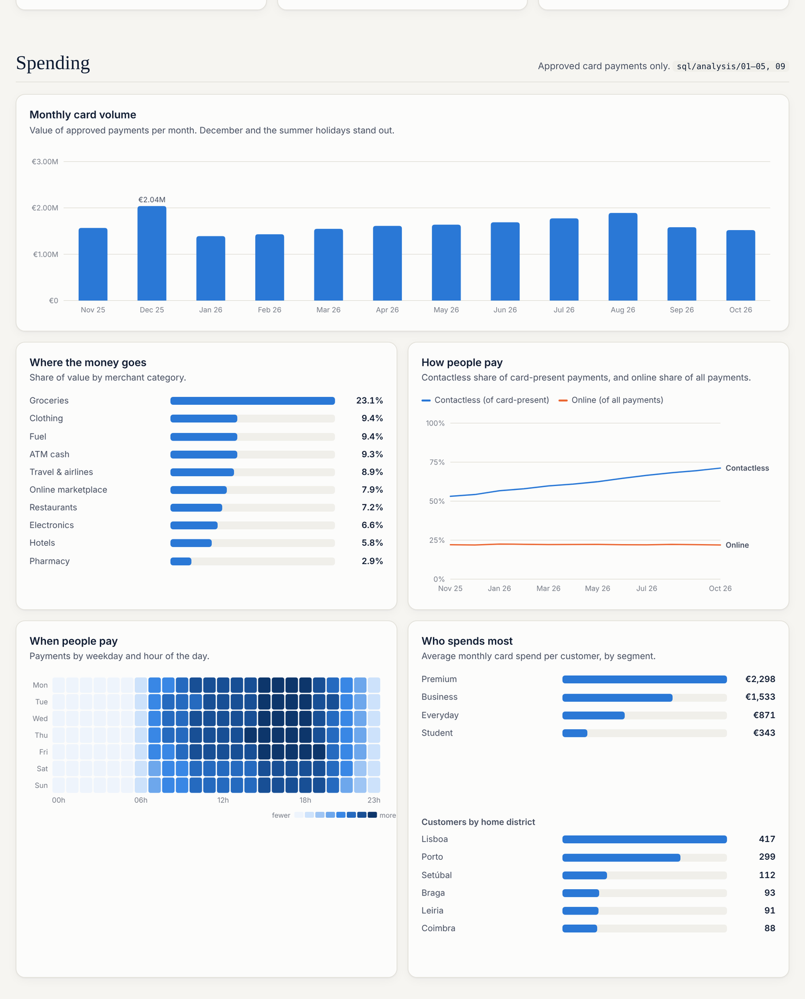 | 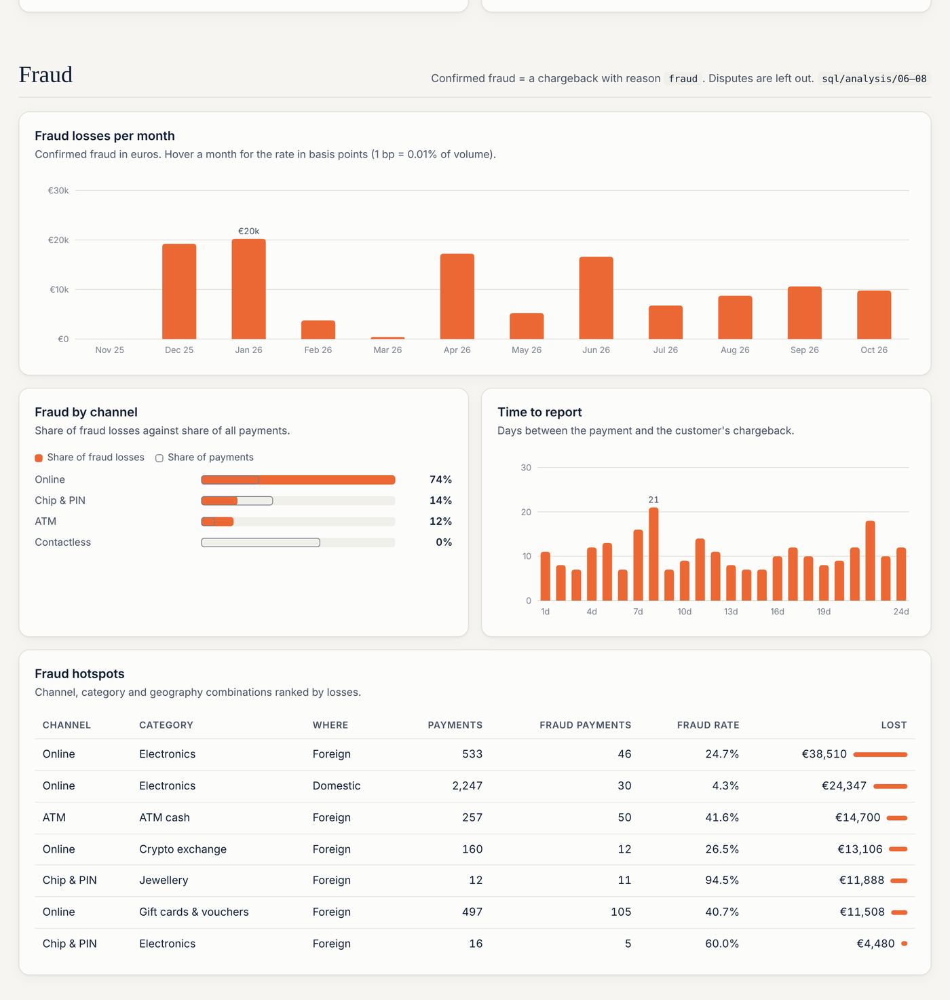 |

| The six checks | Try it: how strict should the bank be? |
| --- | --- |
| 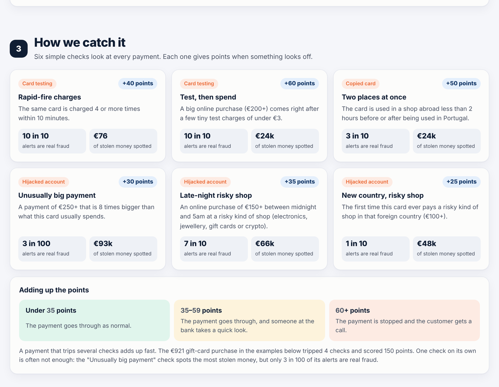 | 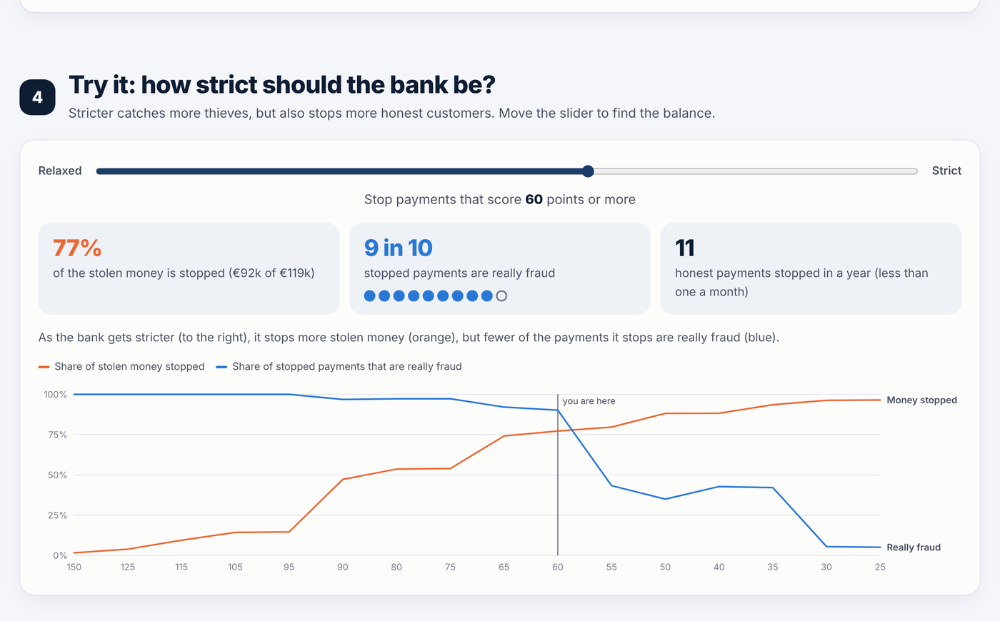 |

| Real examples | For the technical reader |
| --- | --- |
| 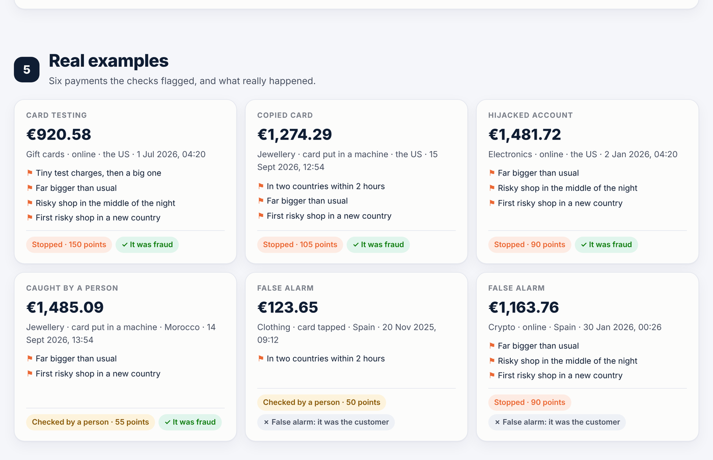 | 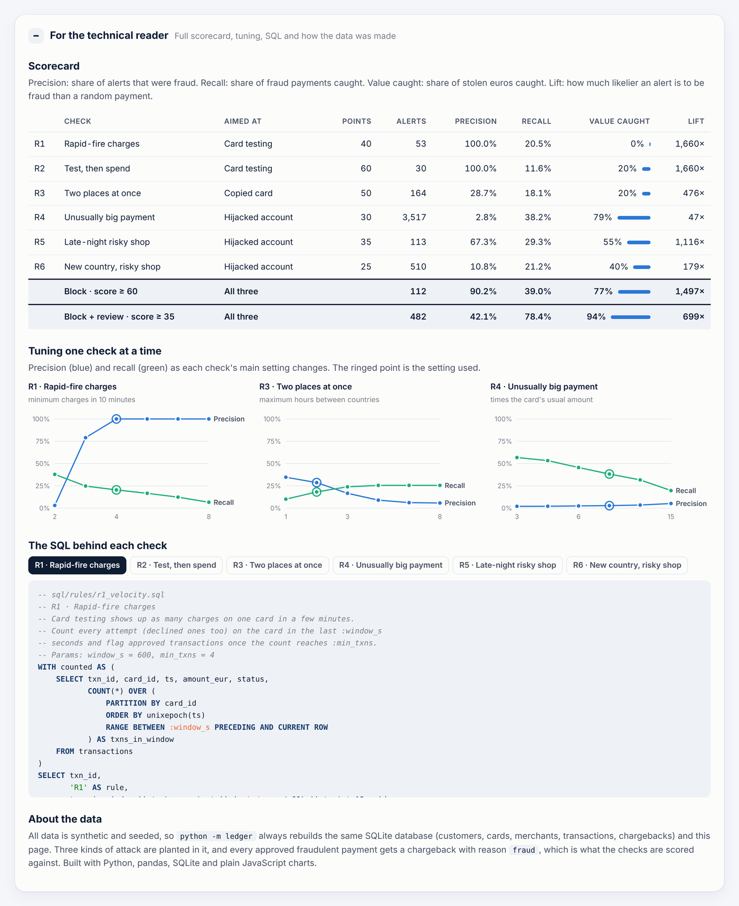 |

| Dark theme | Phone |
| --- | --- |
| 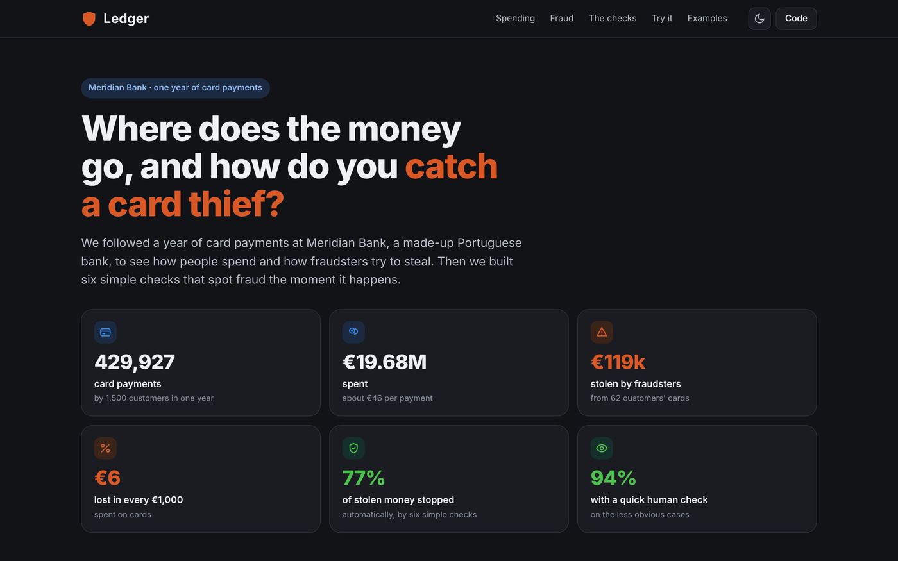 | 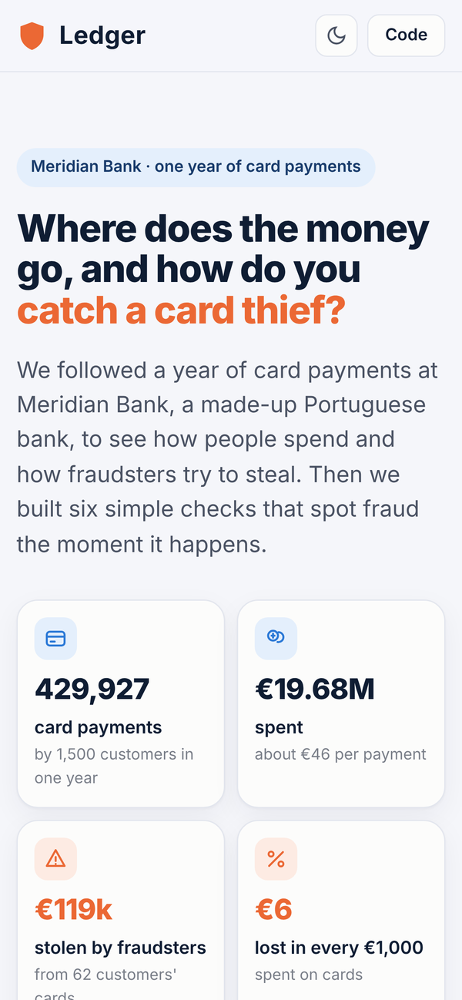 |

| Ask it with AI: [Ledger MCP](https://github.com/DiogoS7/Ledger-MCP) in the MCP Inspector |
| --- |
| 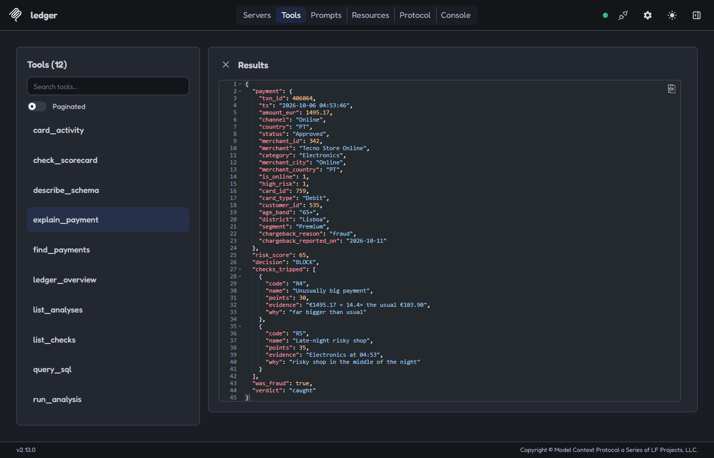 |

## How it works

```
python -m ledger
  │
  ├─ generate   ledger/generate.py  → data/ledger.db   (SQLite, same data every run)
  │                customers · cards · merchants · transactions · chargebacks
  │
  └─ report     ledger/report.py    → site/            (the web page, published to GitHub Pages)
                   runs sql/analysis/*.sql and sql/rules/*.sql through pandas,
                   scores the checks (ledger/rules.py), writes data.json,
                   and copies the page from web/ (plain HTML, CSS and JavaScript charts)
```

The data is synthetic. Everyday spending depends on each customer's type, age and home district, with busy Decembers and summers, trips abroad and more tapping over time. Three tricks are planted in it: **card testing** (tiny charges, then big ones), **copied cards** used abroad while the real card is still at home, and **hijacked accounts** (big night-time purchases online). Every stolen payment later comes back as a fraud claim (a chargeback), which is how the checks are scored. A few genuine disputes are mixed in to keep it honest.

## Project layout

```
ledger/            Python package
  generate.py      builds the SQLite database
  db.py            runs a .sql file and returns a DataFrame
  rules.py         the six checks, scoring, the points system, tuning
  report.py        runs everything and writes the web page
sql/
  schema.sql       tables, constraints and indexes
  analysis/        01–10: spending and fraud queries
  rules/           r1–r6: the checks, plus ground_truth.sql
web/               the page (index.html, styles.css, app.js)
tests/             pytest: every check on hand-made payments, plus end-to-end checks
```

## Run it on your computer

Needs Python 3.10 or newer.

```bash
cd Ledger
pip install -r requirements.txt
python -m ledger                     # build the database and the page (about a minute)
python -m http.server 8000 -d site   # then open http://localhost:8000
```

Open `data/ledger.db` in any SQLite tool (DB Browser for SQLite, DBeaver, VS Code) to run your own queries. `python -m pytest -q` runs the tests.

To ask questions in plain words instead, connect an AI assistant with [Ledger MCP](https://github.com/DiogoS7/Ledger-MCP). It uses this checkout and its database.

## Tests and CI

17 pytest tests. Every check is tested on hand-made payments: it must fire on the trick it targets and stay quiet on the honest behaviour that looks like it (a traveller landing abroad, a busy shopping day, a big purchase with no history). End-to-end tests make sure the data is the same on every run, every query works and the combined score beats the noisiest single check.

GitHub Actions runs the tests on every push, rebuilds the database and the page, and publishes it to GitHub Pages.

## License

[MIT](LICENSE) © Diogo Santos
