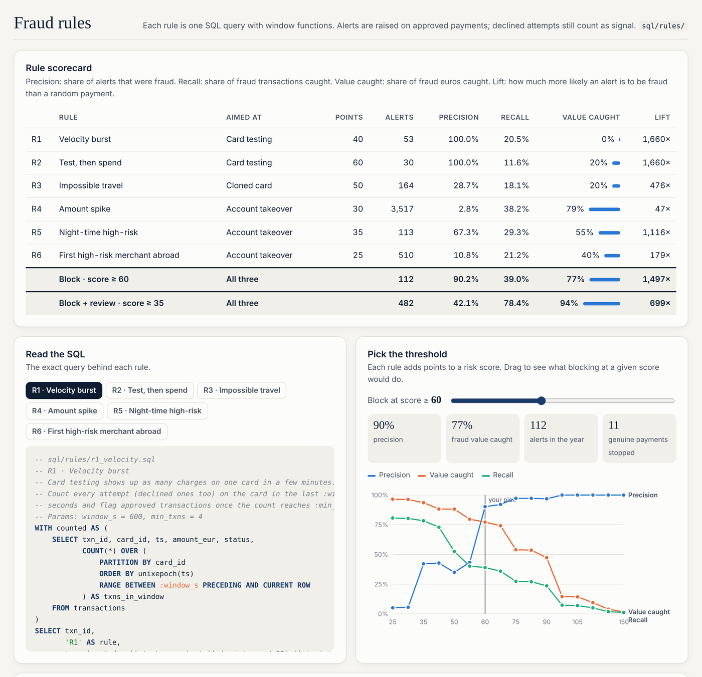
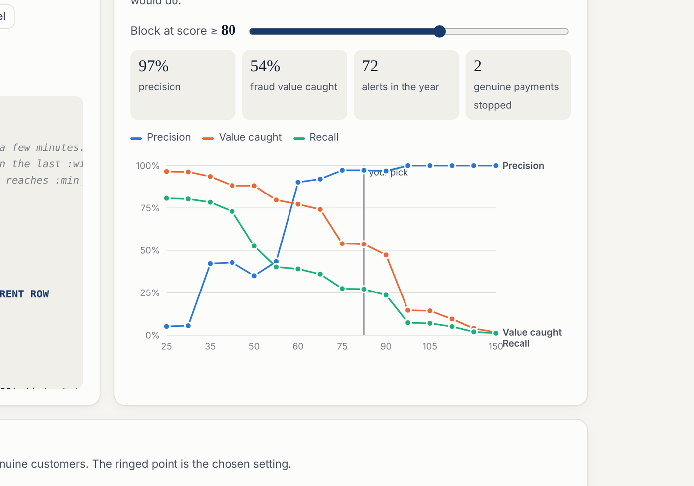
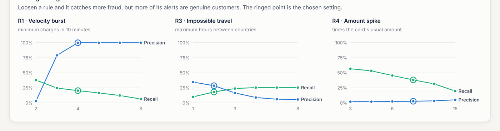
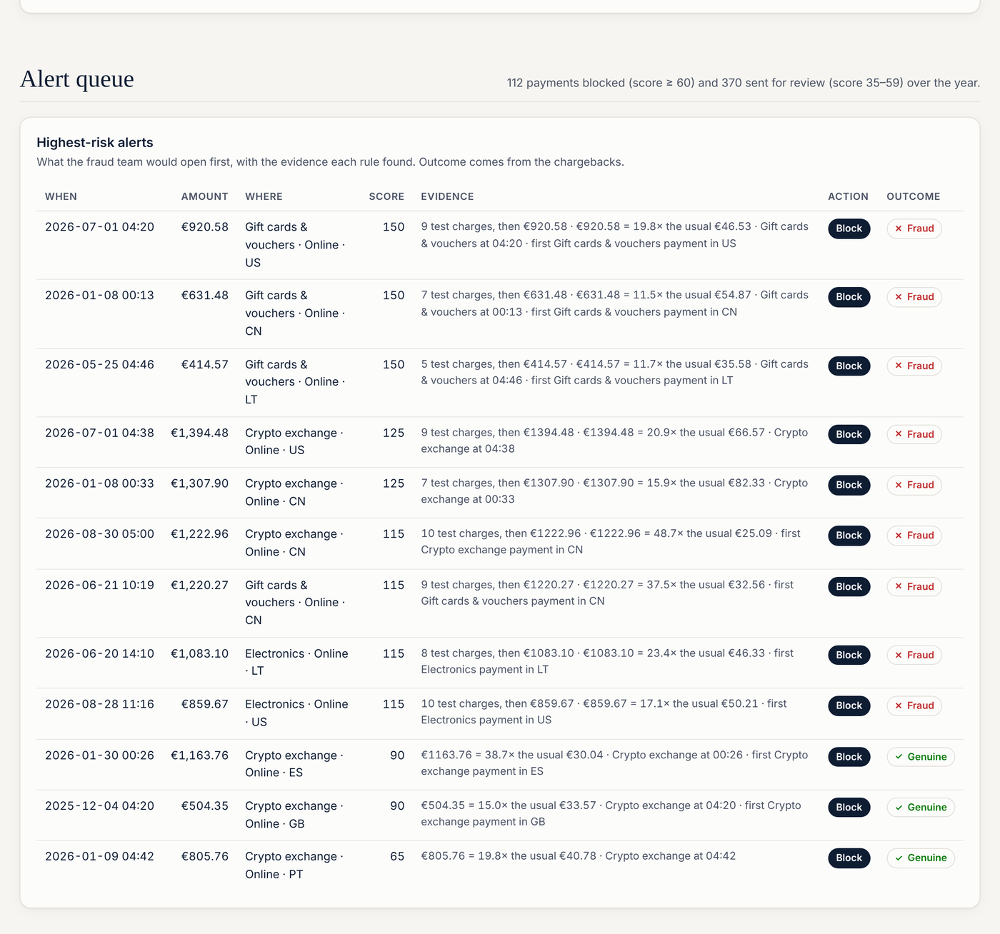

[](https://diogos7.github.io/Ledger/)

# Ledger

[](https://github.com/DiogoS7/Ledger/actions/workflows/ci.yml)

Card fraud and transaction analytics in **Python and SQL**. Live report: **[diogos7.github.io/Ledger](https://diogos7.github.io/Ledger/)**

A year of card payments at Meridian Bank, a fictional Portuguese retail bank: 430,000 payments from 1,500 customers on 2,100 cards. The analysis answers two questions a card portfolio team would ask:

1. **Where does the money go?** Monthly volume, merchant categories, contactless adoption, when people pay and who spends most.
2. **Where does fraud hide, and how do we catch it?** Six fraud rules written in SQL are scored against what actually came back as fraud, then combined into one risk score with a block tier and a review tier.


## Key findings

- **Fraud lives online and abroad.** 74% of fraud losses came through online payments and 79% from foreign merchants, while only 5% of payments happen abroad. Contactless had no fraud at all.
- **Two tiers beat one big net.** Blocking at a risk score of 60 stops 77% of fraud value with 90% precision. A review queue from 35 lifts that to 94% of value, at the cost of 279 genuine payments to check in a year.
- **Single rules are noisy.** The amount-spike rule alone catches the most fraud value, but only 2.8% of its alerts are fraud. As one signal among six it stops being a false-alarm machine.
- **Customers notice late.** Half of the fraud is reported 12 days or more after the payment, so rules have to act at the moment of payment.
- **Contactless keeps growing**, from 53% to 71% of card-present payments over the year.

## The fraud rules

Each rule is a single SQL query in [`sql/rules/`](sql/rules), mostly built on window functions, with its thresholds passed in as named parameters.

| Rule | Aimed at | How it works | Precision | Value caught |
| --- | --- | --- | ---: | ---: |
| R1 Velocity burst | Card testing | 4+ attempts on one card in 10 minutes (`COUNT(*) OVER … RANGE BETWEEN 600 PRECEDING`) | 100% | 0% |
| R2 Test, then spend | Card testing | A €200+ online payment after 3+ charges under €3 in the previous 2 hours | 100% | 20% |
| R3 Impossible travel | Cloned card | Card-present abroad and in Portugal within 2 hours | 29% | 20% |
| R4 Amount spike | Account takeover | 8× the card's average of its last 50 payments, and at least €250 | 3% | 79% |
| R5 Night-time high-risk | Account takeover | Online, high-risk merchant, €150+, between midnight and 5am | 67% | 55% |
| R6 First high-risk merchant abroad | Account takeover | First payment at a high-risk merchant in a new foreign country (`ROW_NUMBER()`) | 11% | 40% |
| **Block · score ≥ 60** | All | Sum of the points of every rule that fires | **90%** | **77%** |
| **Block + review · score ≥ 35** | All | | **42%** | **94%** |

Alerts are raised on approved payments only, but declined attempts still count as signal (a burst of declines is what card testing looks like).

```sql
-- R1 · Velocity burst
WITH counted AS (
    SELECT txn_id, card_id, ts, status,
           COUNT(*) OVER (
               PARTITION BY card_id
               ORDER BY unixepoch(ts)
               RANGE BETWEEN :window_s PRECEDING AND CURRENT ROW
           ) AS txns_in_window
    FROM transactions
)
SELECT txn_id FROM counted
WHERE status = 'Approved' AND txns_in_window >= :min_txns;
```

## Screenshots

| Spending | Fraud |
| --- | --- |
|  |  |

| Rule scorecard and SQL | Pick the threshold |
| --- | --- |
|  |  |

| Tuning a single rule | Alert queue |
| --- | --- |
|  |  |

| Dark theme | Phone |
| --- | --- |
|  |  |

## How it works

```
python -m ledger
  │
  ├─ generate   ledger/generate.py  → data/ledger.db   (SQLite, seeded, same data every run)
  │                customers · cards · merchants · transactions · chargebacks
  │
  └─ report     ledger/report.py    → site/            (static report for GitHub Pages)
                   runs sql/analysis/*.sql and sql/rules/*.sql through pandas,
                   scores the rules (ledger/rules.py), writes data.json,
                   and copies the page from web/ (plain HTML, CSS and JavaScript charts)
```

The data is synthetic. Everyday spending follows each customer's segment, age and home district, with seasonality (December, summer), a growing share of contactless, trips abroad, and some legitimate late-night online shopping. Three kinds of attack are planted in it: **card testing** (tiny online charges, then big ones), **cloned cards** used in shops and ATMs abroad while the real card is still in use at home, and **account takeovers** (night-time online sprees at high-risk merchants). Every approved fraudulent payment gets a chargeback with reason `fraud`, which is the ground truth the rules are scored against. A few genuine disputes are mixed in to keep the analysis honest.

## Project layout

```
ledger/            Python package
  generate.py      builds the SQLite database
  db.py            runs a .sql file and returns a DataFrame
  rules.py         rule definitions, scoring, combined risk score, tuning sweeps
  report.py        runs everything and writes the report site
sql/
  schema.sql       tables, constraints and indexes
  analysis/        01–10: spending and fraud analysis queries
  rules/           r1–r6: the fraud rules, plus ground_truth.sql
web/               the report page (index.html, styles.css, app.js)
tests/             pytest: each rule on hand-made transactions, plus end-to-end checks
```

## Run it locally

Needs Python 3.10 or newer.

```bash
pip install -r requirements.txt
python -m ledger                  # generate the database and build the report (about a minute)
python -m http.server 8000 -d site
# then open http://localhost:8000
```

Open `data/ledger.db` in any SQLite client (DB Browser for SQLite, DBeaver, VS Code) to run your own queries.

```bash
python -m ledger generate --seed 7 --customers 1500   # just the database
python -m ledger report                               # just the report
python -m pytest -q                                   # tests
```

## Tests and CI

17 pytest tests. Every rule is tested on hand-made transactions in an in-memory database: it must fire on the attack it targets and stay quiet on the genuine behaviour that looks like it (a traveller landing abroad, a burst of payments spread over a day, a big purchase with no history). End-to-end tests check that generation is deterministic, the data is consistent, every query runs and the combined score beats the noisiest rule.

GitHub Actions runs the tests on every push, builds the database and the report, and deploys the report to GitHub Pages.

## License

[MIT](LICENSE) © Diogo Santos
